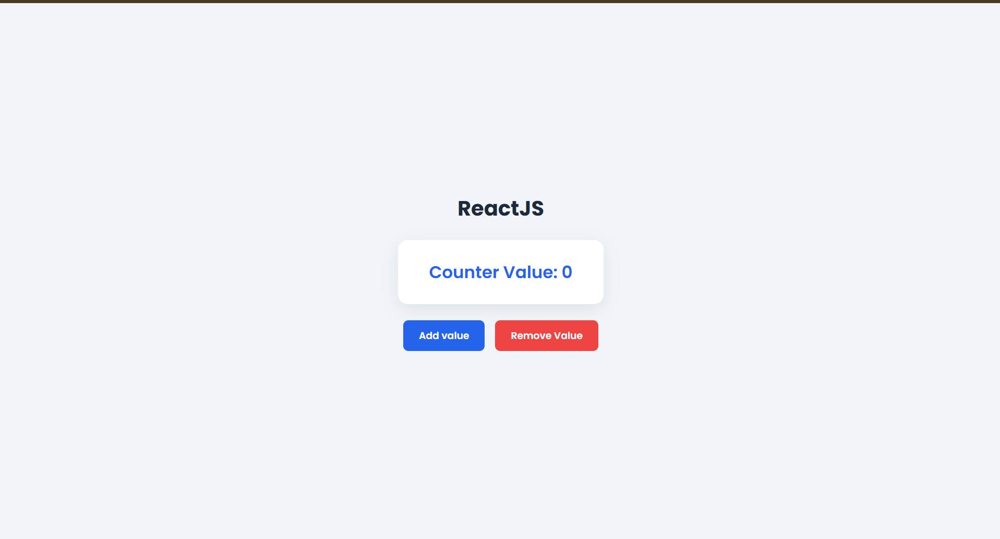

# React Counter App

A simple and interactive Counter Application built with **React.js** and **Vite**. This project demonstrates the fundamentals of React, including state management using the `useState` Hook and handling click events.

## 🚀 Features

- Increment the counter value.
- Decrement the counter value.
- Prevents the counter from going below zero.
- Dynamic UI updates using React state.
- Responsive and clean user interface.

## 🛠️ Technologies Used

- **React.js** – Frontend library
- **Vite** – Development and build tool
- **JavaScript (ES6+)** – Application logic
- **CSS3** – Styling and responsive design
- **HTML5** – Application structure

## 📸 Preview



## 📂 Project Structure

```text
03_counter-project/
├── public/
├── src/
│   ├── App.jsx
│   ├── App.css
│   ├── index.css
│   └── main.jsx
├── index.html
├── package.json
└── README.md
```

## ⚙️ Installation and Setup

1. Clone the repository:

```bash
git clone https://github.com/khairulhoque-cs/ReactJS.git
```

2. Navigate to the project directory:

```bash
cd 03_counter-project
```

3. Install dependencies:

```bash
npm install
```

4. Start the development server:

```bash
npm run dev
```

5. Open the local URL displayed in your terminal.

## 📚 React Concepts Practiced

- Functional Components
- `useState()` Hook
- State Management
- Event Handling (`onClick`)
- Conditional Logic
- JSX
- Component-based Styling

## 🎯 Learning Objective

The main objective of this project is to understand how React manages component state and updates the user interface whenever the state changes.

## 👨‍💻 Author

**Khairul Hoque**

- GitHub: [@khairulhoque-cs](https://github.com/khairulhoque-cs)

---

⭐ If you find this project helpful, consider giving it a star!